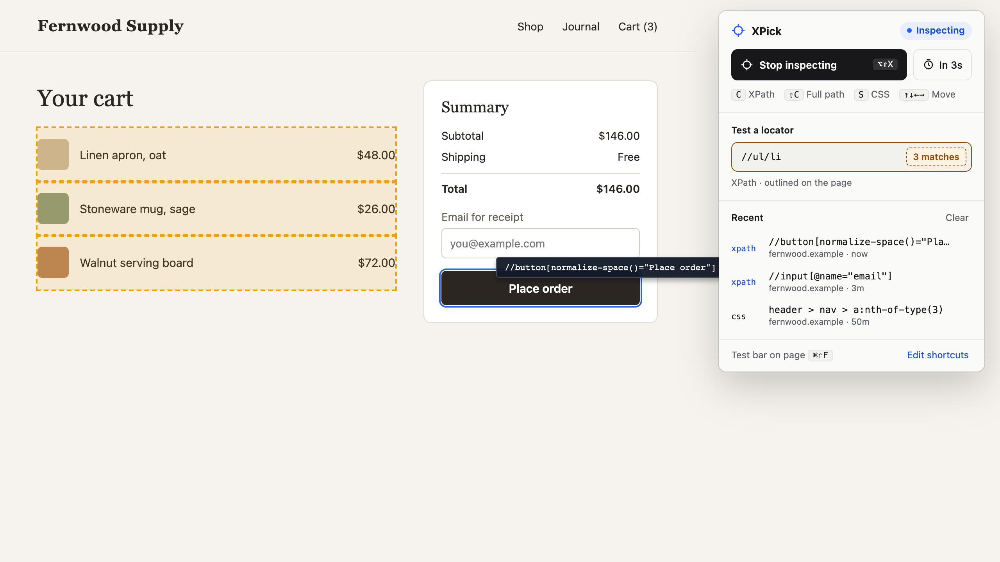

# XPick

Point at any element and copy an XPath or CSS selector that matches only that element. XPick is a Chrome extension for people who write UI tests, scrapers and automation scripts.



## What it does

- **Locators that match one element.** Every XPath and CSS selector is checked against the live page before you get it. If it would match anything else, XPick tries the next option.
- **Stable attributes first.** In order: id, test ids (`data-testid`, `data-test`, `data-cy`, `data-qa`), `name`, `aria-label`, visible text, `placeholder`, `alt`, `title` and `href`.
  - If none of these is unique, it uses a short path from the nearest ancestor that does have one.
  - If that fails too, it uses the full path.
- **Ids that change between builds are skipped.** That covers React `:r1:`, Ember, UUIDs, long numbers, and MUI / Radix / Headless UI ids.
- **Edge cases handled:**
  - SVG and MathML elements, via `local-name()`;
  - values containing both kinds of quote, via `concat()`;
  - duplicate ids.
- **Test any locator.** Type an XPath or CSS selector and every match is outlined on the page.
- **Hover menus.** "In 3s" starts the inspector after a delay, so you can open a dropdown or tooltip first.
- **Recent copies.** The last 10 locators you copied are listed in the popup. Click one to copy it again.

## Install

From a release:

1. Download `xpick-<version>.zip` from [Releases](https://github.com/AwasthiNikhil/xpick/releases) and unzip it.
2. Open `chrome://extensions` and turn on **Developer mode**.
3. Click **Load unpacked** and choose the unzipped folder.

From source, do the same with a clone of this repo.

## Use it

Click the toolbar button, or press the shortcut, and hover over the page.

| Key | Does |
|---|---|
| <kbd>C</kbd> or click | Copy the best XPath |
| <kbd>Shift</kbd> + <kbd>C</kbd> | Copy the full (absolute) XPath |
| <kbd>S</kbd> | Copy a CSS selector |
| <kbd>↑</kbd> <kbd>↓</kbd> <kbd>←</kbd> <kbd>→</kbd> | Move to the parent, first child or siblings |
| <kbd>Esc</kbd> | Stop inspecting |

The badge next to the cursor shows the XPath you'll get and why it was picked: `id`, `test id`, `text`, `inside id` and so on.

### Shortcuts

| Shortcut | Default |
|---|---|
| Start or stop inspecting | <kbd>Alt</kbd> + <kbd>Shift</kbd> + <kbd>X</kbd> |
| Open the test bar on the page | <kbd>Ctrl</kbd> + <kbd>Shift</kbd> + <kbd>F</kbd> (<kbd>⌘</kbd> + <kbd>Shift</kbd> + <kbd>F</kbd> on Mac) |

You can change either one at `chrome://extensions/shortcuts`, or from **Edit shortcuts** in the popup.

The test bar is the fastest way to check a locator. Press the shortcut, paste, and the matches are outlined.
- <kbd>Enter</kbd> or <kbd>↓</kbd> goes to the next match, and <kbd>Shift</kbd> + <kbd>Enter</kbd> or <kbd>↑</kbd> to the previous one.
- <kbd>Tab</kbd> moves between the bar's buttons.
- <kbd>Esc</kbd> closes it.

It edits like a normal input, even on pages that block text selection or swallow keys.

## Permissions and privacy

XPick asks for `activeTab`, `scripting` and `storage`, and nothing else.
- It runs only on the tab where you click the button or press a shortcut, and only after you do.
- It doesn't run on every page in the background.
- Your recent copies stay in Chrome's local extension storage.
- Nothing is sent anywhere.

## Limits

- **Chrome's own pages:** extensions can't run on `chrome://` pages or the Chrome Web Store.
- **Shadow DOM:** elements inside a shadow root can't be reached by XPath, so XPick points at the shadow host and says so.
- **Iframes:** elements inside an iframe aren't inspected yet. Hovering one selects the iframe itself.
- **Local files:** to inspect files opened from your disk, turn on **Allow access to file URLs** for XPick at `chrome://extensions`.

## Development

There's no build step: the extension is the plain files in the repo root.

```sh
npm ci
npx playwright install chromium
npm test
```

The tests use Playwright and run in two parts:
- `tests/xpath.spec.js` checks locator generation against tricky markup. It then sweeps every element of the fixture page and of 150 randomly generated pages, checking that each locator matches exactly one element.
- `tests/extension.spec.js` loads the real extension into Chromium. It covers the copy keys, arrow navigation, the test box and test bar, history, permissions, and taking over from a copy left behind by an extension reload.

CI runs the same suite on every push.

| File | Role |
|---|---|
| `xpath.js` | Locator generation and checking. No `chrome.*` APIs, so the tests run it directly. |
| `content.js`, `content.css` | The inspector, badge, outlines and test bar, injected into the page on demand |
| `inject.js` | Injects the inspector into a tab when needed. Shared by the popup and the service worker. |
| `background.js` | Keyboard shortcuts |
| `popup.html`, `popup.js` | The toolbar popup ([reference](docs/popup-reference.png)) |
